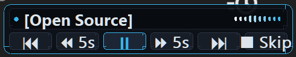

# AudioMind 🎙️⚡
**Ambient Voice Companion & Screen Intelligence for Google Antigravity**

[](https://microsoft.com)
[](https://android.com)
[](https://python.org)
[](https://fastapi.tiangolo.com)
[](LICENSE)
[-8A2BE2?logo=googlepodcasts)](docs/PODCAST_TRANSCRIPT.md)

---

## The Story

When doing heavy daily engineering with Google Antigravity, output from complex coding sessions was often manually copied into system read-aloud utilities just to listen to refactors, test traces, and architectural explanations hands-free.

That friction sparked a builder question: **what if Antigravity had a native ambient voice companion?**

We built a lightweight Windows taskbar harness that sits in the system tray, animates an ambient translucent waveform HUD, watches session transcripts in real-time, and speaks responses aloud with sub-second latency. Soon after, we realized we needed remote control—so when away from the workstation (cooking, driving, or walking around the house), we could say:

> *"Hey Google, tell Antigravity to run the unit test suite and report results."*

...and desktop Antigravity would focus, execute, acknowledge via cloud relay, and speak back the complete summary to the phone.

This repository is that complete, end-to-end full-stack voice companion system.

### 🎙️ Listen to the 7-Minute Deep Dive Explainer
Hear the AI hosts break down why AudioMind was built—from the dreaded "15-minute idle tax" and 1998 robotic microwave voice hacks to the CD-player HUD and zero-trust AST firewall:
- 🎧 **Audio Episode**: [`docs/media/audiomind_deep_dive_podcast.m4a`](docs/media/audiomind_deep_dive_podcast.m4a)
- 📝 **Full Timecoded Transcript & Show Notes**: [`docs/PODCAST_TRANSCRIPT.md`](docs/PODCAST_TRANSCRIPT.md)
- 📖 **Project Wiki**: [`wiki/Home.md`](wiki/Home.md)

---

## System Architecture

```text
┌────────────────────────────────────────┐
│     Android Companion (:app)           │
│  - Glowing Holographic Mic             │
│  - Quick Action Chips (Tests, Git)     │
│  - Google Assistant App Actions        │
│  - Voice VI Neural TTS + Pause/Resume  │
└──────────────────┬─────────────────────┘
                   │
                   │ HTTPS POST /api/agent/dispatch
                   ▼
┌────────────────────────────────────────┐
│     Cloud Relay Broker (FastAPI)       │
│  - Encrypted Dispatch Queue            │
│  - Token-Based Tenant Isolation        │
│  - Delivery & Execution Acknowledgment │
└──────────────────┬─────────────────────┘
                   │
                   │ HTTPS GET /api/agent/pending (Polling Daemon)
                   ▼
┌────────────────────────────────────────┐
│     Desktop Voice Harness (Win32)      │
│  - Windows Taskbar System Tray Icon    │
│  - Translucent Floating Waveform HUD   │
│  - 'Hey Anti' Custom ONNX Wake-Word    │
│  - Win32 Foreground Lock Bypass Focus  │
│  - Real-Time Transcript Stream Watcher │
└────────────────────────────────────────┘
```

---

## Subsystems

### 1. Desktop Voice Harness (`desktop/`)
* **System Tray & Waveform HUD**: Native Windows notification tray app with a dark menu, real-time status indicators (Idle, Listening, Thinking, Speaking, Paused), and a floating translucent waveform HUD animating real-time microphone and speaker audio. **Click anywhere on the waveform HUD** to interactively pause or resume speech.

<p align="center">
  
</p>

* **Read Highlighted Text Anywhere**: Select any text on your screen across any application (Antigravity IDE, browser, PDF reader, Slack, Word, terminal, etc.) and click **"📖 Read Highlighted Text"** in the tray menu, press global hotkey **`Ctrl+Alt+R`**, or say *"Hey Anti, read this"* / *"read highlighted text"*. Anti captures the selection, animates the waveform HUD, and reads it aloud with chapter seeking, pause/resume, and 5s rewind/forward controls.
* **Audio Playback Navigation**: Granular speech navigation available directly in the system tray menu (`⏩ Forward 5s`, `⏪ Rewind 5s`, `⏭ Skip Chapter`, `⏮ Repeat Chapter`, `⏸ Pause/Resume`, `⏹ Stop`) and via hands-free voice commands (*"pause"*, *"resume"*, *"stop"*, *"rewind"*, *"skip chapter"*, *"repeat chapter"*). Automatically extracts structured chapters from markdown headings, numbered lists, paragraphs, or sentence clusters for seamless seeking. Evaluated only when speech is active with whole-phrase matching to eliminate voice intent collisions.
* **Safe Focus & UIPI Protection**: Focuses Antigravity chat directly via `Ctrl+L` and double-checks foreground window focus before typing. Queries Win32 `TokenElevation` to prevent synthetic typing when Antigravity IDE runs with elevated privileges, speaking an audible explanation.
* **Transcript Watcher**: Streams active conversation updates from `<appDataDir>\brain\<conversation-id>\.system_generated\logs\transcript.jsonl` with unabridged hydration up to 1,200 words.
* **Win32 Window Focus**: Safely bypasses Windows foreground lock restrictions (`LockSetForegroundWindow` / `AttachThreadInput`) to bring Antigravity into focus when a voice command arrives.
* **AST Command Firewall**: Validates and isolates incoming commands before injection, strictly guarding against destructive operations and out-of-boundary paths.
* **Custom Wake-Word**: Bundled `hey_anti.onnx` model calibrated for hands-free desktop voice activation.

### 2. Android Mobile Companion (`android/`)
* **Cyberpunk / Antigravity Aesthetic**: Dedicated dark HUD (`#06090E`) with cyan glowing mic button, authentic Antigravity parabolic arch glyphs, and responsive `WindowInsets` keyboard padding.
* **Hands-Free Google Assistant**: Registered App Actions (`shortcuts.xml`) and system intents (`VOICE_COMMAND`, `SEARCH_ACTION`, `SEND`) allowing voice triggers like *"Hey Google, open Antigravity"*. All external intents are staged for explicit user confirmation before dispatch.
* **Neural Speech Engine**: Integrates Google TTS with automatic pitch & rate inheritance from Android OS Settings (1.14x default), supporting full 3-state pause/resume playback (`⏸ Pause Voice` $\rightarrow$ `▶ Resume Voice` $\rightarrow$ `🔊 Replay Voice`).
* **Configurable Relay Endpoint**: Connects to your local or hosted Cloud Relay service with bearer token authentication stored securely in `EncryptedSharedPreferences`.

### 3. Cloud Relay Broker (`relay/`)
* **Lightweight & High-Throughput**: Built with FastAPI and SQLAlchemy (SQLite by default; PostgreSQL ready). Sub-10ms response times for dispatch and polling.
* **Zero-Cost Compute**: Designed for Always Free Tier hosting (Google Cloud Run or `e2-micro`), using minimal memory.
* **REST Endpoints**:
  * `POST /api/agent/dispatch`: Mobile companion queues voice instruction.
  * `GET /api/agent/pending`: Desktop harness polls for incoming tasks.
  * `POST /api/agent/ack`: Desktop reports execution outcome and summary.
  * `GET /api/agent/status/{id}`: Telemetry status check.
  * `GET /health`: Health-check endpoint.

---

## Prerequisites

* **Operating System**: Windows 10/11 (for Desktop HUD and WASAPI AEC loopback capture).
* **Python**: 3.12 or 3.13 (64-bit recommended).
* **Google Antigravity**: Antigravity IDE / CLI (`agy`) installed and available on PATH or in default location (`%LOCALAPPDATA%\agy\bin\agy.exe`).
* **Android Development (Optional)**: Android Studio Hedgehog or newer, JDK 17+, Android SDK 34+.

---

## Quickstart

### 1. Configuration Setup

Copy the example environment file to `.env`:

```powershell
cp .env.example .env
```

Edit `.env` to configure your shared relay secret and endpoints:
* Set `RELAY_AUTH_SECRET` to a strong random token (must be at least 32 characters).
* For local testing on the same machine, `REMOTE_DISPATCH_API_URL` can be set to `http://127.0.0.1:8000`.

### 2. Running the Cloud Relay Broker

```powershell
cd relay
pip install -r requirements.txt
python server.py
# Server runs at http://127.0.0.1:8000 (docs at http://127.0.0.1:8000/docs)
```

### 3. Running the Desktop Voice Harness (Windows)

```powershell
# In project root:
python -m venv .venv
.\.venv\Scripts\Activate.ps1
pip install -r desktop/requirements.txt

# Run desktop HUD & tray application:
python desktop/app.py
```

*Tip: You can also double-click `scripts/Launch_AudioMind.bat` or run `scripts/launch_anti_tray.vbs` to launch silently into the system tray.*

### 4. Building the Android Companion App

```powershell
cd android
.\gradlew.bat assembleDebug

# Install to connected device or emulator:
.\gradlew.bat installDebug
```

---

## Verification & Testing

Run all test suites across the repository:

* **Desktop Subsystem Tests**:
  ```powershell
  cd desktop && pytest tests/
  ```
* **Cloud Relay Tests**:
  ```powershell
  cd relay && pytest -q
  ```
* **Android Unit Tests**:
  ```powershell
  cd android && .\gradlew.bat test
  ```

---

## Troubleshooting

### Windows UIPI & Process Elevation Mismatch
* **Symptom**: When issuing a voice command or remote dispatch, Anti announces:
  > *"Antigravity is running as administrator, so Anti can't type into it."*
  (or remote dispatches ACK with status `FAILED`).
* **Cause**: On Windows, User Interface Privilege Isolation (UIPI) blocks standard-integrity processes from sending synthetic keystrokes (`keybd_event` / `SendInput`) into windows owned by elevated (Administrator) processes.
* **Fix**: Ensure Antigravity IDE runs at standard user integrity by clearing the `~ RUNASADMIN` compatibility flag:
  1. Right-click `Antigravity IDE.exe` (or its shortcut) $\rightarrow$ select **Properties**.
  2. Navigate to the **Compatibility** tab.
  3. Uncheck **"Run this program as an administrator"** and click **OK**.
  4. *(Registry alternative)*: Remove the `Antigravity IDE.exe` value from `HKEY_CURRENT_USER\Software\Microsoft\Windows NT\CurrentVersion\AppCompatFlags\Layers`.
  5. Restart Antigravity IDE normally.
  > [!NOTE]
  > Do **not** run `desktop/app.py` as Administrator. Both Antigravity and AudioMind should operate at standard user integrity to adhere to the principle of least privilege.

---

## Security & Privacy Invariants

### Transparency & External Data Disclosures
Before running AudioMind, please review the following data flows and network dependencies:
1. **Speech Recognition (STT)**: Spoken voice input captured via the microphone is streamed to the Google Speech-to-Text API for acoustic transcription.
2. **Text-to-Speech (TTS)**: Assistant response text and read-aloud excerpts are synthesized via Microsoft Edge-TTS neural cloud services.
3. **IDE Transcript Watcher**: The desktop background daemon monitors and reads conversation transcripts located at `~/.gemini/antigravity/brain` in order to detect completed assistant responses and speak them aloud.
4. **Local Logging**: Dispatched instructions, recognition results, and firewall evaluations are logged locally to `audiomind_tray.log` (or `anti_tray.log`) in the application directory.
5. **Firewall Boundary Disclaimer**: The AST Command Firewall (`desktop/firewall/`) is an advisory guard against accidental commands and malformed instructions, **not** an impregnable security boundary against adversarial prompt injection. The Antigravity IDE agent's own native permission and execution approval settings remain the ultimate security boundary.

### Security Guarantees & Defenses
* **Fail-Closed Authentication**: The Cloud Relay rejects unauthenticated requests with HTTP 401 using constant-time `hmac.compare_digest`. The server refuses to start if `RELAY_AUTH_SECRET` is unset or shorter than 32 characters.
* **Tenant Isolation**: Dispatches are strictly isolated by tenant ID derived exclusively from verified credentials; client-controlled tenant headers are discarded.
* **No Remote Auto-Execution**: Remote instructions received over the relay are screened by the firewall, capped in length, stripped of control characters, and pasted into the IDE chat for manual confirmation. Remote instructions are **never** auto-submitted without human review.
* **Zero Silent Intent Execution on Mobile**: The Android companion strictly validates URLs (refusing non-HTTPS endpoints outside debug loopbacks), stores credentials in `EncryptedSharedPreferences`, and stages external intents (`SEND`, App Actions, Shortcuts) for explicit user confirmation rather than executing them silently.
* **Local-First Relay Defaults**: The relay server binds by default to `127.0.0.1` without auto-reload enabled.

---

## Vulnerability Reporting

Please report security issues responsibly. See [`SECURITY.md`](SECURITY.md) for details.

---

## License

Distributed under the **Apache License 2.0**. See [`LICENSE`](LICENSE) for details.
